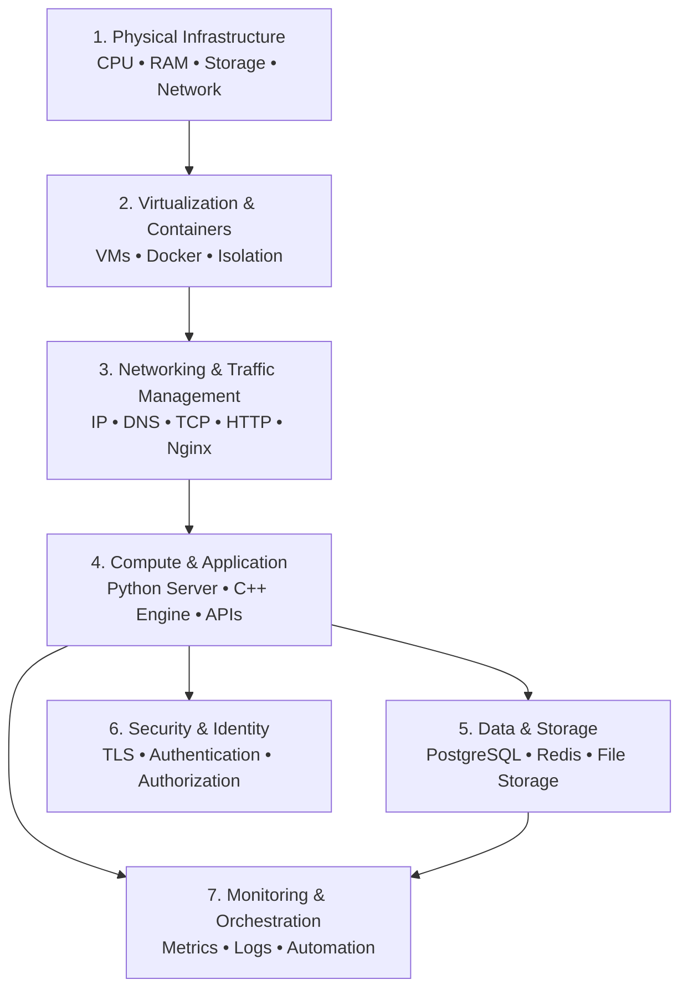
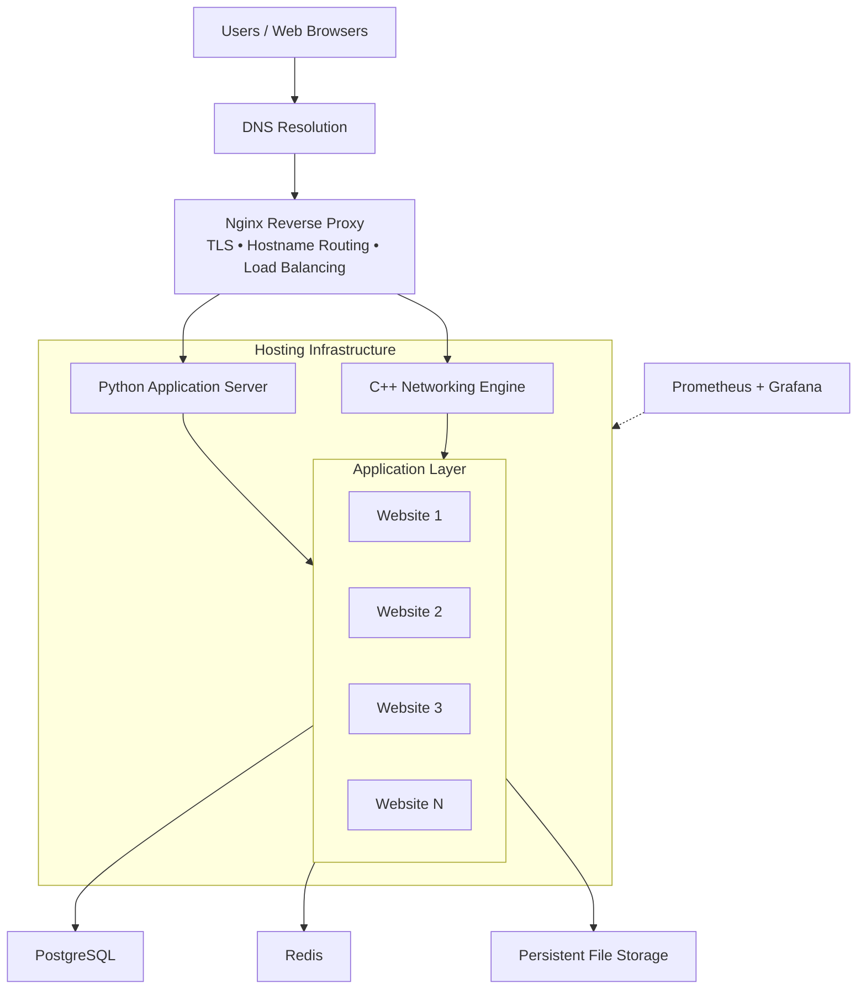

# Build Your Own Server Infrastructure

<p align="center">
  
  
  
  
</p>

<p align="center">
  <strong>Building server infrastructure from the ground up — understanding every layer, from TCP sockets to cloud architecture.</strong>
</p>

<p align="center">
  <a href="#-project-overview">Overview</a> •
  <a href="#-architecture">Architecture</a> •
  <a href="#-technology-stack">Tech Stack</a> •
  <a href="#-development-roadmap">Roadmap</a> •
  <a href="#-cpp-implementation">C++ Phase</a> •
  <a href="#-project-structure">Structure</a>
</p>

---

## 🌐 Project Overview

**Build Your Own Server Infrastructure** is a systems engineering project focused on understanding how modern web servers, hosting platforms, and cloud infrastructure work internally.

Instead of relying entirely on existing frameworks and managed cloud services, the objective is to progressively build the underlying components ourselves.

The project begins with a basic HTTP server written in Python using raw TCP sockets. It will gradually evolve into a multi-website hosting environment with backend applications, databases, reverse proxies, containerization, monitoring, and infrastructure automation.

Once the Python implementation is sufficiently developed, performance-critical networking components will be reimplemented in **C++** to explore low-level systems programming, memory management, concurrency, and performance optimization.

### 🎯 The ultimate objective

Build a small-scale hosting platform capable of managing approximately **100 lightweight websites**, subject to hardware resources, workload characteristics, and performance testing.

The objective is not simply to deploy websites. It is to understand and implement the infrastructure responsible for hosting, routing, isolating, securing, monitoring, and scaling them.

### Core capabilities we aim to develop

- [x] Establish a TCP server using Python sockets.
- [x] Accept incoming client connections.
- [x] Construct and send basic HTTP responses.
- [x] Implement basic HTTP request parsing and routing.
- [x] Handle multiple clients using threads.
- [ ] Serve static files, including HTML, CSS, JavaScript, and images.
- [ ] Implement more complete HTTP request handling.
- [ ] Develop REST APIs and backend application support.
- [ ] Integrate PostgreSQL and persistent storage.
- [ ] Host multiple websites using hostname-based routing.
- [ ] Introduce reverse proxying and load balancing.
- [ ] Implement application isolation using containers.
- [ ] Add authentication, authorization, and HTTPS.
- [ ] Build monitoring and infrastructure management.
- [ ] Rewrite the networking core in C++.
- [ ] Benchmark and optimize the infrastructure.

---

## 🏗️ Architecture

Cloud infrastructure does not follow one universally fixed number of layers. For this project, we use seven logical layers to understand how the different components work together.



### The seven infrastructure layers

| Layer | Responsibility | Technologies / Concepts |
|---|---|---|
| 1. Physical infrastructure | Hardware and computing resources | CPU, RAM, SSD, NIC |
| 2. Virtualization | Resource abstraction and isolation | Virtual Machines, Docker |
| 3. Networking | Communication and traffic distribution | TCP/IP, DNS, HTTP, Nginx |
| 4. Compute and applications | Server processes and hosted applications | Python, C++, REST APIs |
| 5. Data and storage | Persistent data and caching | PostgreSQL, Redis, File Storage |
| 6. Security and identity | Protecting applications and users | TLS, Authentication, Authorization |
| 7. Monitoring and orchestration | Observability and infrastructure management | Prometheus, Grafana, Terraform, Kubernetes |

<details>
<summary><strong>How these layers work together</strong></summary>

When a user visits a hosted website:

1. DNS resolves the website's domain to an IP address.
2. The client establishes a TCP connection with the server.
3. HTTP communicates the requested resource.
4. A reverse proxy can identify the requested hostname and forward the request to the correct application.
5. The application processes the request and may query a database or cache.
6. Security mechanisms verify that the request is permitted.
7. Monitoring systems record performance, resource usage, and errors.

The response then travels back through the network to the client.

</details>

---

## ⚙️ Technology Stack

The project introduces technologies progressively. Each technology will be added when its underlying functionality becomes necessary.

### Primary languages

<p>
  <a href="https://www.python.org/"></a>
  <a href="https://isocpp.org/"></a>
</p>

| Language | Purpose |
|---|---|
| Python | Initial server implementation, HTTP handling, application logic and automation |
| C++ | Low-level networking, connection management, concurrency and performance-critical components |
| SQL | Database queries, data management and application persistence |
| Bash | Linux administration and infrastructure scripting |

### Infrastructure and development technologies

<p>
  <a href="https://ubuntu.com/"></a>
  <a href="https://learn.microsoft.com/en-us/windows/wsl/"></a>
  <a href="https://www.docker.com/"></a>
  <a href="https://www.nginx.com/"></a>
  <a href="https://www.postgresql.org/"></a>
  <a href="https://redis.io/"></a>
</p>

### Complete technology map

| Category | Technology | Planned application |
|---|---|---|
| Development environment | Ubuntu, WSL2 | Linux development environment on Windows |
| Networking | TCP/IP, sockets | Client-server communication |
| Application protocol | HTTP/1.1, later HTTP/2 and HTTP/3 concepts | Request and response handling |
| Python networking | `socket`, `threading`, `asyncio` | Server implementation and concurrency |
| C++ networking | Linux sockets, Boost.Asio | High-performance networking engine |
| Backend | Python | REST APIs and application execution |
| Database | PostgreSQL | Persistent application data |
| Reverse proxy | Nginx | Routing and traffic management |
| Caching | Redis | Frequently accessed data and caching |
| Containers | Docker, Docker Compose | Application packaging and isolation |
| Monitoring | Prometheus, Grafana | Metrics and visualization |
| Messaging | RabbitMQ | Asynchronous task communication |
| Infrastructure as Code | Terraform | Infrastructure provisioning |
| Orchestration | Kubernetes | Container orchestration and scaling |

**Note:** Kubernetes, RabbitMQ, Terraform, and other advanced technologies are future learning targets, not requirements for the initial server.

---

## 🔄 Development Roadmap

The project follows a progressive engineering approach: understand the concept, implement it, test it, measure it, and then improve it.

### Phase 1 — Environment and Linux Fundamentals

<kbd>FOUNDATION</kbd>

- Set up Ubuntu using WSL2.
- Understand Linux directory structures and file permissions.
- Learn processes, threads, ports, and system services.
- Configure Python, C++, GCC/G++, Git, and development tools.
- Understand how programs interact with the operating system.

### Phase 2 — Building the First HTTP Server

<kbd>COMPLETED FOUNDATION</kbd>

- Explore Python's built-in HTTP server.
- Create a server using Python's `socket` module.
- Understand TCP socket creation, binding, listening, and accepting.
- Construct HTTP responses manually.
- Parse HTTP request lines and headers.
- Implement basic URL routing.
- Handle client connections using threads.

**Current implementation:** A basic Python HTTP server listening on port `8000`, with simple GET routing, HTTP responses, error handling, and threaded client handling.

### Phase 3 — Networking Fundamentals

<kbd>IN PROGRESS</kbd>

- Client-server architecture.
- IP addresses, ports, and network interfaces.
- TCP connection establishment and termination.
- TCP reliability, sequencing, retransmission, and flow control.
- UDP and its differences from TCP.
- HTTP request and response structure.
- DNS resolution.
- Network debugging using tools such as `ping`, `curl`, `ss`, and Wireshark.

### Phase 4 — Concurrency and Connection Management

- Compare sequential and multithreaded servers.
- Implement an asynchronous server using `asyncio`.
- Understand blocking and non-blocking I/O.
- Study thread pools and resource limits.
- Implement connection timeouts.
- Handle incomplete requests and disconnected clients.
- Benchmark concurrent connections.

### Phase 5 — Static Website Hosting

- Serve HTML, CSS, JavaScript, and images from disk.
- Implement MIME type detection.
- Build safe file-path resolution.
- Prevent directory traversal.
- Handle missing files and HTTP error responses.
- Implement basic caching and file delivery.
- Test hosting multiple static websites.

### Phase 6 — Backend and Database Infrastructure

- Build a REST API layer.
- Implement GET, POST, PUT, and DELETE.
- Connect Python applications to PostgreSQL.
- Learn database connections and connection pooling.
- Implement registration and login.
- Introduce password hashing.
- Implement authentication and authorization.
- Understand sessions, tokens, and permissions.

### Phase 7 — Web Server Infrastructure

- Introduce Nginx as a reverse proxy.
- Understand upstream servers.
- Route requests to different backend applications.
- Introduce load balancing.
- Explore caching strategies.
- Configure logging and error handling.
- Study HTTPS, TLS certificates, and firewall fundamentals.

### Phase 8 — Multi-Website Hosting

- Implement hostname-based routing.
- Host independent websites on a shared machine.
- Create per-site configuration files.
- Separate website directories and application processes.
- Introduce resource limits.
- Prevent one application's failure from affecting other sites.
- Measure CPU, RAM, network, and storage consumption.

### Phase 9 — Cloud Infrastructure and Orchestration

- Understand virtual machines and cloud instances.
- Containerize applications using Docker.
- Manage multiple services using Docker Compose.
- Explore cloud deployment.
- Configure load balancing across multiple instances.
- Introduce Prometheus and Grafana.
- Explore infrastructure automation using Terraform.
- Learn Kubernetes fundamentals.
- Study horizontal scaling, fault tolerance, and distributed systems.

---

## 🚀 C++ Implementation

After developing and understanding the Python infrastructure, the next major objective is to reimplement selected performance-critical components in C++.

This phase will focus on systems programming rather than simply translating Python syntax into C++.

### Components to implement

| Component | Python implementation | C++ implementation |
|---|---|---|
| TCP sockets | `socket` | Linux socket API |
| HTTP parsing | Custom parser | Custom parser |
| Connection management | Python threads / asyncio | Threads / asynchronous I/O |
| Request processing | Python functions | C++ modules |
| Memory management | Python-managed memory | Explicit resource management |
| Event-driven networking | `asyncio` | Boost.Asio |
| Performance testing | Python benchmarking | C++ benchmarking |

### What we want to understand

- How operating systems manage sockets.
- How TCP connections consume system resources.
- How memory allocation affects performance.
- How multithreading and asynchronous I/O differ.
- How event loops manage large numbers of connections.
- How C++ can improve performance in selected workloads.
- How to design interfaces between different language components.

### Benchmarking objectives

The Python and C++ implementations will be compared using:

- Requests per second.
- Average and percentile response latency.
- Concurrent connection handling.
- CPU utilization.
- Memory consumption.
- Throughput under different workloads.

The objective is to obtain measurable results rather than assume that one language is always faster.

---

## 🧩 Target Infrastructure Architecture

The following represents the intended architecture as the project evolves. It is a target design, not the current implementation.



### Architecture components

| Component | Responsibility |
|---|---|
| DNS | Resolves domain names to server addresses |
| Nginx | Reverse proxy, TLS termination and traffic distribution |
| Python server | Application and backend request processing |
| C++ engine | Selected low-level networking operations |
| Website instances | Independent hosted applications |
| PostgreSQL | Persistent relational data |
| Redis | Caching and fast data access |
| File storage | Website assets and application files |
| Monitoring | Infrastructure metrics and performance visibility |

The architecture may evolve as testing reveals better ways to separate networking, application execution, storage, and infrastructure management.

---

## 📁 Project Structure

The repository will evolve as new components are implemented.

```text
build-your-own-server/
│
├── core/
│   ├── server.py
│   ├── connection.py
│   └── request_handler.py
│
├── networking/
│   ├── tcp/
│   ├── http/
│   ├── dns/
│   └── routing/
│
├── applications/
│   ├── website1/
│   ├── website2/
│   └── website3/
│
├── database/
│   ├── connection.py
│   ├── models/
│   └── migrations/
│
├── security/
│   ├── authentication/
│   ├── authorization/
│   └── permissions/
│
├── monitoring/
│   ├── metrics/
│   └── logging/
│
├── config/
│   ├── server_config.json
│   └── sites/
│
├── cpp/
│   ├── networking/
│   ├── http/
│   ├── concurrency/
│   └── benchmarks/
│
├── tests/
│   ├── networking/
│   ├── integration/
│   └── performance/
│
├── logs/
│
├── requirements.txt
├── README.md
└── main.py
```

---

## 🧪 Testing and Performance Evaluation

Building a server is only one part of the project. Understanding how it behaves under different conditions is equally important.

Testing will progressively cover:

| Test | What it measures |
|---|---|
| Functional testing | Correctness of HTTP requests and responses |
| Connection testing | Ability to establish and close connections |
| Concurrency testing | Handling multiple simultaneous clients |
| Load testing | Performance under increasing request volume |
| Stress testing | Behavior near resource limits |
| Latency testing | Time taken to respond to requests |
| Memory testing | Memory usage under different workloads |
| Fault testing | Behavior when applications or connections fail |

The target of approximately 100 lightweight websites will be evaluated through repeatable tests on the available hardware. Actual capacity will depend on application workloads, traffic, memory, CPU, storage, and network constraints.

---

## 📚 What This Project Teaches

This project combines several important areas of computer science and software engineering.

| Domain | Concepts |
|---|---|
| Operating Systems | Processes, threads, scheduling, memory management, system calls |
| Computer Networks | TCP/IP, UDP, DNS, sockets, routing, HTTP |
| Systems Programming | Low-level I/O, resource management, concurrency |
| Backend Engineering | REST APIs, request processing, authentication |
| Database Systems | SQL, indexing, transactions, connection pooling |
| Web Infrastructure | Reverse proxies, load balancing, TLS |
| Cloud Computing | Virtualization, containers, resource allocation |
| Distributed Systems | Scaling, fault tolerance, service communication |
| DevOps | Deployment, automation, monitoring |
| C++ Development | Memory management, asynchronous I/O, performance optimization |

---

## 🛡️ Security and Project Limitations

This is an educational project and should not be treated as production-ready infrastructure.

Before public deployment, the system will need appropriate security and reliability measures, including:

- Robust HTTP parsing and input validation.
- Safe static-file path handling.
- TLS/HTTPS configuration.
- Authentication and authorization.
- Application and process isolation.
- Resource limits and connection limits.
- Secure database credentials and access controls.
- Firewall configuration.
- Logging, monitoring, and incident handling.
- Protection against denial-of-service and other common attacks.

**Do not expose the early development server directly to the public internet.** Initial development and testing should remain on localhost or a controlled network.

---

## 🛠️ Getting Started

### Prerequisites

- Windows with WSL2, or a Linux environment.
- Ubuntu installed and configured.
- Python 3.
- Git.
- A code editor such as VS Code.

### Run the current Python server

```bash
python3 server.py
```

Open the following address in your browser:

```text
http://localhost:8000
```

The current implementation is a learning server. Its request parser and connection handling are intentionally simplified and will be improved throughout the roadmap.

---

## 📌 Development Philosophy

The project follows six engineering principles:

1. **Understand before implementing** — learn the underlying operating-system and networking concepts.
2. **Build before abstracting** — implement basic components manually before introducing frameworks.
3. **Test every layer** — verify functionality before expanding the architecture.
4. **Measure before optimizing** — use benchmarks instead of assumptions.
5. **Separate responsibilities** — keep networking, application logic, storage, and infrastructure independently understandable.
6. **Scale progressively** — move from one server to multiple applications, then to distributed infrastructure.

---

## 🌟 Final Objective

The final outcome should be more than a basic HTTP server.

It should be a practical, progressively engineered hosting infrastructure that demonstrates how modern server systems operate — from low-level TCP communication and HTTP processing to multi-application hosting, resource isolation, containerization, monitoring, and cloud architecture.

**The emphasis is on understanding how infrastructure works internally, not simply knowing how to deploy an application on it.**

<p align="center">
  <strong>Learn the fundamentals. Build the components. Measure the system. Scale the infrastructure.</strong>
</p>

---

<p align="center">
  <sub>Educational systems engineering project • Python → C++ • Server Infrastructure → Cloud Architecture</sub>
</p>